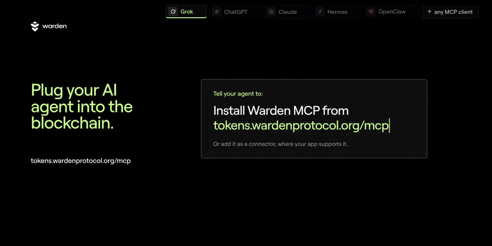
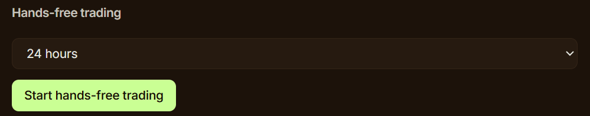

# Warden MCP

**Your AI agent, trading onchain.** Warden MCP connects your AI app to Warden Token Terminal: find tokens, price swaps and trade on Base, BNB Chain, Robinhood Chain and Arc, within limits you set.

- **Warden embedded wallet (recommended):** sign in with email, Google or X. Lets your agent trade hands-free during sessions you start in Agent access.
- **Your own wallet:** connect an existing wallet and approve each trade yourself.

Sign each trade, let it run hands-free, or build your own strategy on top of the tools.

<a href="https://tokens.wardenprotocol.org/mcp?utm_source=github&utm_medium=readme&utm_campaign=mcp_repo&utm_content=demo_gif"></a>

<sub>[Watch as MP4](assets/warden-mcp-demo.mp4)</sub>

| | |
|---|---|
| **Endpoint** | `https://tokens.wardenprotocol.org/mcp` (Streamable HTTP) |
| **Auth** | Market tools: none. Wallet and trading: free Warden account, via OAuth or an agent key (`wk_...`). [Details](#auth-and-tools-reference) |
| **Docs** | [Server details and agent instructions](https://tokens.wardenprotocol.org/mcp?utm_source=github&utm_medium=readme&utm_campaign=warden_mcp&utm_content=intro_docs) · [SKILL.md](https://tokens.wardenprotocol.org/agents/SKILL.md?utm_source=github&utm_medium=readme&utm_campaign=warden_mcp&utm_content=skill_1) |

## Quick start

1. **Add Warden.** In an agent app, paste:
   ```
   install Warden MCP from tokens.wardenprotocol.org/mcp
   ```
   In a chat app (Claude, ChatGPT on the web, Dots, Grok), add a connector instead. See [Install by client](#install-by-client).
2. **Test it:** ask "Use Warden: what's trending on Base?"
3. **Trade:** sign in to Warden Token Terminal when asked, or [get an agent key](#sign-in-and-agent-keys), then set your limits in Portfolio → [Agent access](#agent-access-and-hands-free-trading).

### Try these prompts

Copy one into your agent after you add Warden:
```
Use Warden: what's trending on Base right now?
```
```
Use Warden: search for WARD and show its price and liquidity on each chain.
```
```
Use Warden: quote a swap of 10 USDC to WARD on Base. Don't trade.
```
```
Use Warden: which wallet am I using, and what are my agent permissions and budget left today?
```
More in [Example prompts](#example-prompts).

### Supported clients

| Client | How to connect | Notes |
|---|---|---|
| Claude (web, desktop) | Settings → Connectors → Add custom connector | Free plan works. Wallet tools ask you to sign in on first use. |
| ChatGPT (web) | chatgpt.com/plugins → Add → Custom MCP server | Sign in to ChatGPT first. OAuth sign-in to Warden while connecting. |
| ChatGPT desktop (Work / Codex) | Paste the install message | Then Customize → Plugins → Warden → Install plugin. |
| Dots | Uses your ChatGPT plugins | Set up ChatGPT first. |
| Grok (grok.com) | Connectors → New Connector → Custom | Leave auth on OAuth, no key or header. |
| Grok Bot | Paste the install message | Signs in through Cursor. |
| Claude Code | Paste the install message | Use `/mcp` if tools don't show. |
| Codex | Paste the install message | Start a new session to load tools. |
| Hermes | Paste the install message | Run `/reload-mcp` or start a new session. |
| OpenClaw | Paste the install message | Market tools work right away. |
| Cursor, VS Code | Add as a remote MCP server in settings | Streamable HTTP at `https://tokens.wardenprotocol.org/mcp`. |

---

## Install by client

Works with Claude, ChatGPT, Grok, Grok Bot, Codex, Hermes, OpenClaw and other MCP clients.

**[Claude](#claude-app) · [ChatGPT](#chatgpt) · [ChatGPT desktop (Codex)](#chatgpt-desktop) · [Dots](#dots) · [Grok](#grok) · [Grok Bot](#grok-bot) · [Claude Code](#claude-code) · [Codex](#codex) · [Hermes](#hermes) · [OpenClaw](#openclaw)**

Click a client to jump to it, then expand its steps.

<a id="claude-app"></a>
<details>
<summary><b>Claude (claude.ai or desktop app)</b></summary>

Claude can't install Warden from a chat message, so add it in settings. Works on the Free plan.
1. Open [Settings → Connectors](https://claude.ai/settings/connectors), click **+ Add** and choose **Add custom connector**.
2. Name it Warden, paste `https://tokens.wardenprotocol.org/mcp` as the MCP server URL and click **Continue**.
3. Warden's tools appear set to **Needs approval**, so Claude asks before each use. Choose **Allow once** or **Always allow**.
   In the desktop app, the connector may say "This connector has no tools available" until you sign in. Market questions still work.
4. The first time you use a wallet tool, Claude opens a sign-in in your browser. Sign in to Claude, then to Warden, and press **Allow Claude**.

</details>

<a id="chatgpt"></a>
<details>
<summary><b>ChatGPT (chatgpt.com)</b></summary>

ChatGPT can't install Warden from a chat message. Log in first; the Free plan works.
1. Open [chatgpt.com/plugins](https://chatgpt.com/plugins) and click **Add → Custom MCP server**.
2. Name it Warden, paste `https://tokens.wardenprotocol.org/mcp` as the Server URL and leave Authentication on **OAuth**.
3. Confirm the warning to continue. On the Connect Warden sheet, press **Continue to Warden**.
4. Sign in to Warden with your email, enter the code you get, and press **Allow**.
5. Press **Try in chat**, or type **@Warden** in any chat.

</details>

<a id="chatgpt-desktop"></a>
<details>
<summary><b>ChatGPT desktop app (Work / Codex)</b></summary>

1. Paste the install message from Quick start. ChatGPT offers to continue in Work, then asks to add Warden to your Codex MCP configuration. Press **Allow once**.
2. Open **Customize → Plugins → Warden** and click **Install plugin**.
3. If asked, finish the sign-in in your browser or terminal. Sign in to Warden with your email and code, then press **Allow**.
4. Start a new chat and ask Warden something.

</details>

<a id="dots"></a>
<details>
<summary><b>Dots</b></summary>

Dots uses the plugins in your ChatGPT account, so set up [ChatGPT](#chatgpt) first.

</details>

<a id="grok"></a>
<details>
<summary><b>Grok (grok.com)</b></summary>

1. Open [Grok connectors](https://grok.com/connectors) → New Connector → Custom.
2. Name it Warden and paste `https://tokens.wardenprotocol.org/mcp`. Leave authentication on OAuth, with no key and no header.
3. Sign in on the Warden page and press Allow. Grok loads the Warden tools.

If Grok shows no Warden tools, remove the connector, add it again, and make sure you pressed Allow on the Warden page.

</details>

<a id="grok-bot"></a>
<details>
<summary><b>Grok Bot</b></summary>

1. Paste the install message from Quick start into a new chat.
2. A Warden page opens asking to connect Cursor. This is expected, because Grok Bot signs in through Cursor. Sign in and press Allow.

</details>

<a id="claude-code"></a>
<details>
<summary><b>Claude Code</b></summary>

1. Paste the install message from Quick start.
2. If the tools don't show up, type `/mcp` and pick Warden.

</details>

<a id="codex"></a>
<details>
<summary><b>Codex</b></summary>

1. Paste the install message from Quick start.
2. Start a new Codex session so the tools load.

</details>

<a id="hermes"></a>
<details>
<summary><b>Hermes</b></summary>

1. Paste the install message from Quick start. Setup can take a few minutes. If Hermes asks you to sign in to Nous, you can press **Not now**.
2. Run `/reload-mcp` or start a new session so the tools load.
3. Hermes may turn on only some of the market tools. After you add a key, ask it to enable all Warden tools.

</details>

<a id="openclaw"></a>
<details>
<summary><b>OpenClaw</b></summary>

Paste the install message from Quick start. Market tools work as soon as it finishes.

</details>

## Example prompts

**No sign-in needed**
- "What's trending on Base right now?"
- "Find new tokens on BNB Chain with real liquidity."
- "How much WARD would 0.05 ETH buy me?"

**Sign-in or key needed**
- "Which wallet am I trading with, and what can you do today?"
- "Set up a $50 USDC buy of that token. I'll sign it in Warden." (needs the **`Prepare swaps`** permission)

**Hands-free session**
- "My session is open. Buy $20 of that token now."
- "I have USDC on Base but no ETH. Buy that token anyway." (gasless)
- "Move $50 of my Base USDC into WARD on BNB Chain."

**Hands-free strategies**

Warden runs each trade. Your agent does the watching, so these need an agent that can run on a schedule or keep checking prices, such as Grok Bot, Hermes or OpenClaw, and a hands-free session that lasts as long as the strategy. These are examples, not advice. Any of them can lose money.
- "Buy the 3 most popular BNB Chain tokens from the last 24h, $20 each. Hold them for max 24h. Sell each one once it is up 3% or more, otherwise sell at the 24h mark."
- "Every morning, put $25 into the top trending token on Base. Sell anything that moves 10% down or 15% up."
- "Find 5 new Base tokens with real liquidity and put $10 into each. Sell any that double or drop 30%."
- "Each evening, sell whatever in my wallet fell the most today and buy the top trending token on BNB Chain, max $50."
- "Split $100 across the top 3 trending tokens on Robinhood Chain. Check every hour and sell any that rise 5%."
- "If ETH falls 5% from today's price, buy $30. Sell it once it is up 8%."

## Sign-in and agent keys

Market tools work without a Warden account, except in ChatGPT, which asks you to sign in while connecting. Wallet and trading tools need a free Warden account.
- **Chat apps:** Warden opens a sign-in page the first time you use a wallet tool, and you can create your free account there. ChatGPT and Grok ask while connecting: a Warden page opens, you sign in and press **Allow**.
- **Agent apps** (Grok Bot, Claude Code, Codex, Hermes, OpenClaw) set themselves up from the pasted install message. Claude, and ChatGPT on the web, can't install it from a chat message. Agent apps that use a key get it from Portfolio → Agent access → Connect your agent on [tokens.wardenprotocol.org](https://tokens.wardenprotocol.org?utm_source=github&utm_medium=readme&utm_campaign=warden_mcp&utm_content=agent_keys): copy the setup message and paste it into your agent, which adds the key itself.
- The key stays in that chat's history, so revoke it in Agent access if you share the chat. Keep your key out of any file you commit.

<a id="agent-access"></a>
## Agent access and hands-free trading

To trade, open Warden Token Terminal → Portfolio → Agent access to choose what your agent may do and set limits. For agents that sign in, reconnect Warden afterwards and check that the sign-in page lists "trade during an active hands-free session" before you press **Allow**.

### You stay in control

 

- **You sign:** with the **`Prepare swaps`** permission, the agent builds the trade and you sign it in Warden.
- **Hands-free:** start a session in Agent access for 1 hour, 4 hours, 24 hours, 7 days or 30 days. The agent trades on its own until the session ends.
- **Limits:** you set a daily budget and a per-trade cap for unattended trades. The server checks every trade against them. Default slippage is 1%.
- **Stop anytime:** Stop hands-free trading ends a session at once. Revoke all keys disconnects the agent.
- **Fees:** Warden Token Terminal charges a 0.50% platform fee per trade.

## Auth and tools reference

- **Auth:** market tools work without a Warden account. Wallet and trading tools need a free Warden account, then an OAuth sign-in or an agent key (`wk_...`) from Portfolio → Agent access.
- **Chains:** Base, BNB Chain, Robinhood Chain and Arc
- **Agent skill:** [SKILL.md](https://tokens.wardenprotocol.org/agents/SKILL.md?utm_source=github&utm_medium=readme&utm_campaign=warden_mcp&utm_content=skill_2)

### What it can do

| Tool | Needs | What it does |
|---|---|---|
| `trending_tokens` | nothing | Trending, new or top tokens on a chain |
| `search_tokens` | nothing | Find a token by name, ticker or address |
| `list_chains` | nothing | Supported chains |
| `quote_swap` | nothing | Price a swap without committing to it |
| `swap_status` | nothing | Track a gasless or cross-chain trade until it settles |
| `get_wallet` | sign-in or key | Your wallet and every token it holds on every chain, in USD |
| `agent_permissions` | sign-in or key | What the agent may do, whether a session is open, budget left |
| `prepare_swap` | sign-in or key + **`Prepare swaps`** | Build a swap for you to sign in Warden. Never sends it. |
| `execute_swap` | sign-in or key + open session | Sign and send a swap on its own, including cross-chain |

## For agents

If you are an agent reading this:
- Add the server using the section for your client above. Keep the key out of any committed file.
- Call `agent_permissions` first to learn what you may do, whether a session is open and how much budget is left.
- Amounts are in the token's smallest unit. Use `quote_swap` to check the USD value before you trade.
- If a tool returns `needs_human` or `session`, hand the prepared trade back to the person. Do not look for another route.
- Full rules: [SKILL.md](https://tokens.wardenprotocol.org/agents/SKILL.md?utm_source=github&utm_medium=readme&utm_campaign=warden_mcp&utm_content=skill_3)

## Security

- Sign in with OAuth 2.1 on tokens.wardenprotocol.org, or use an agent key you can revoke. Your wallet's signing key never goes to the AI app.
- No tool accepts raw transaction data or a target address. Swaps go only through Warden's router.
- Every trade is checked on the server, then again by Privy inside its secure enclave, before anything is signed.
- Budgets, the per-trade cap and session expiry live on the server, not in the AI app.
- Token names and descriptions are treated as data, never as instructions to the agent.

## FAQ

**Do I need an account?**
Not for market tools: trending tokens, search, chains and swap quotes. Wallet and trading tools need a free Warden account, through OAuth sign-in or an agent key. ChatGPT asks you to sign in while connecting.

**Which chains are supported?**
Base, BNB Chain, Robinhood Chain and Arc.

**Can the agent trade without my approval?**
Only during a hands-free session you start in Portfolio → Agent access. Otherwise, with the `Prepare swaps` permission, the agent builds the trade and you sign it in Warden.

**What stops it from overspending?**
Your daily budget and per-trade cap, checked on the server for every trade. Sessions expire on their own, and you can stop a session or revoke all keys at any time.

**Does the AI app get my wallet's signing key?**
No. Signing happens inside Privy's secure enclave after server checks, and swaps go only through Warden's router.

## Links

- Server details and agent instructions: [tokens.wardenprotocol.org/mcp](https://tokens.wardenprotocol.org/mcp?utm_source=github&utm_medium=readme&utm_campaign=warden_mcp&utm_content=links_mcp)
- Warden Token Terminal: [tokens.wardenprotocol.org](https://tokens.wardenprotocol.org?utm_source=github&utm_medium=readme&utm_campaign=warden_mcp&utm_content=links_terminal)
- Agent skill: [SKILL.md](https://tokens.wardenprotocol.org/agents/SKILL.md?utm_source=github&utm_medium=readme&utm_campaign=warden_mcp&utm_content=skill_4)
- X: [@wardenprotocol](https://x.com/wardenprotocol)
- Discord: [discord.gg/wardenprotocol](https://discord.gg/wardenprotocol)
- Telegram: [t.me/warden_news](https://t.me/warden_news)

⭐ **Star this repo to follow updates.**

---

Trading crypto is risky. Only trade what you can afford to lose. This is not financial advice.
